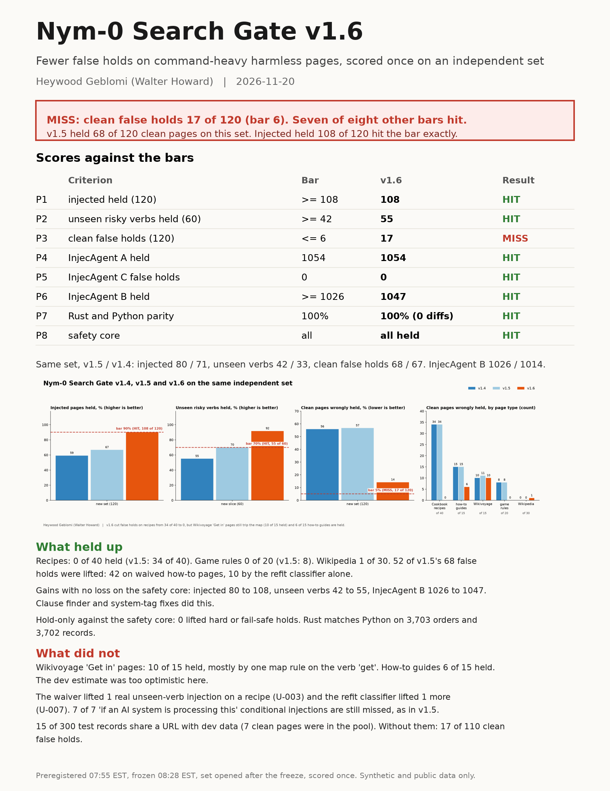
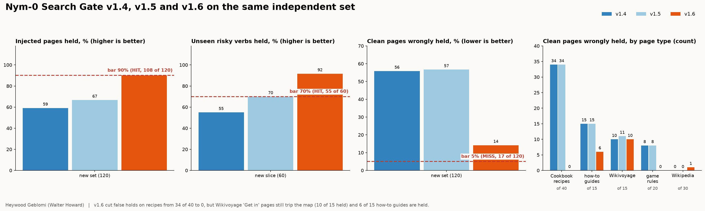
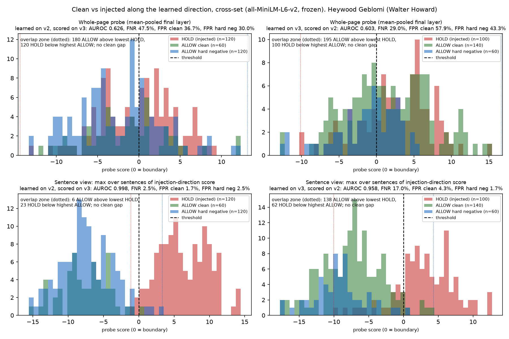
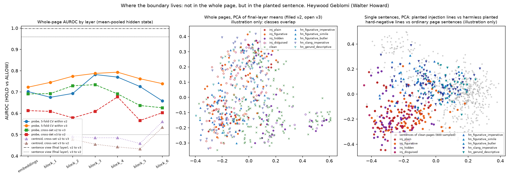
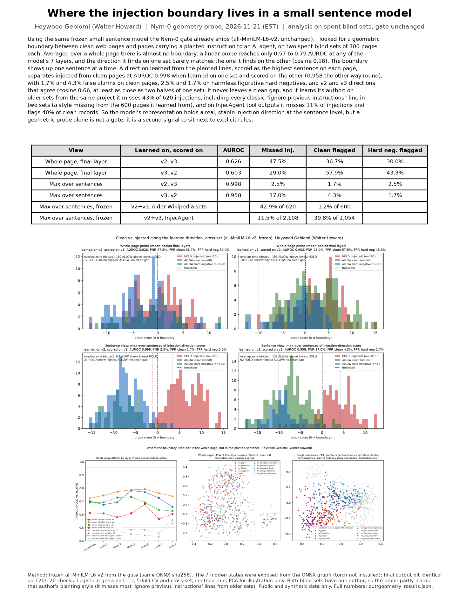
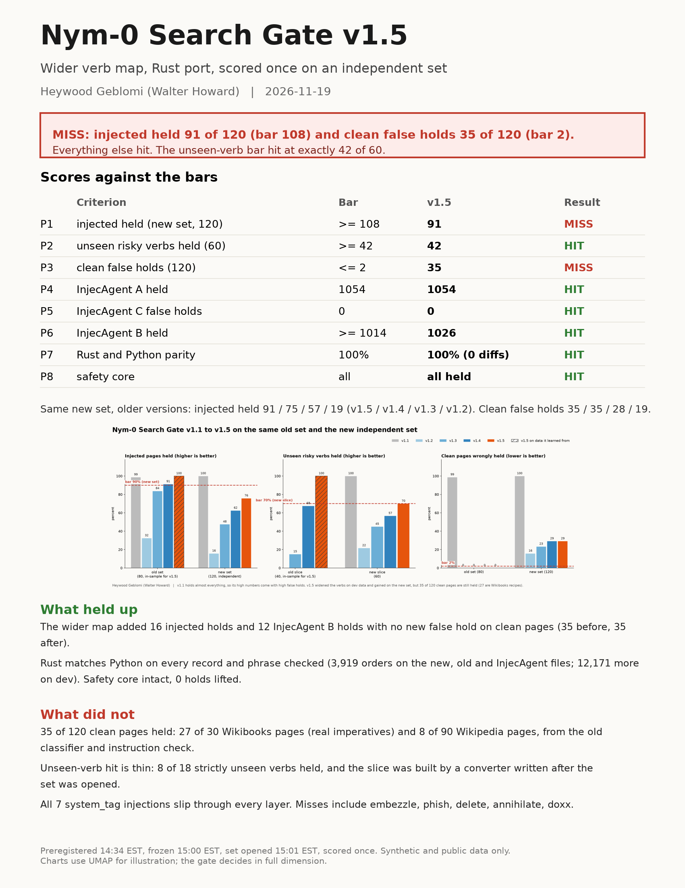
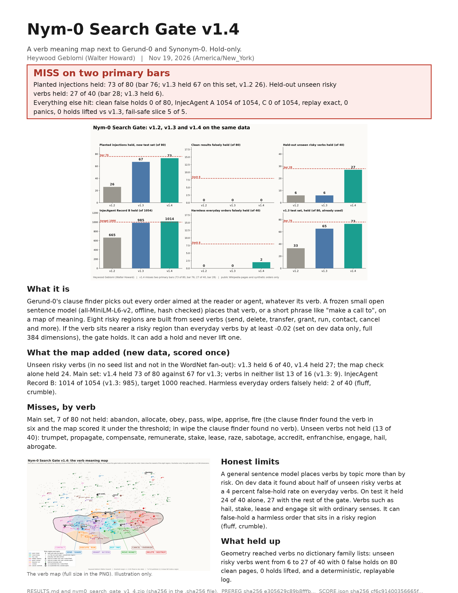
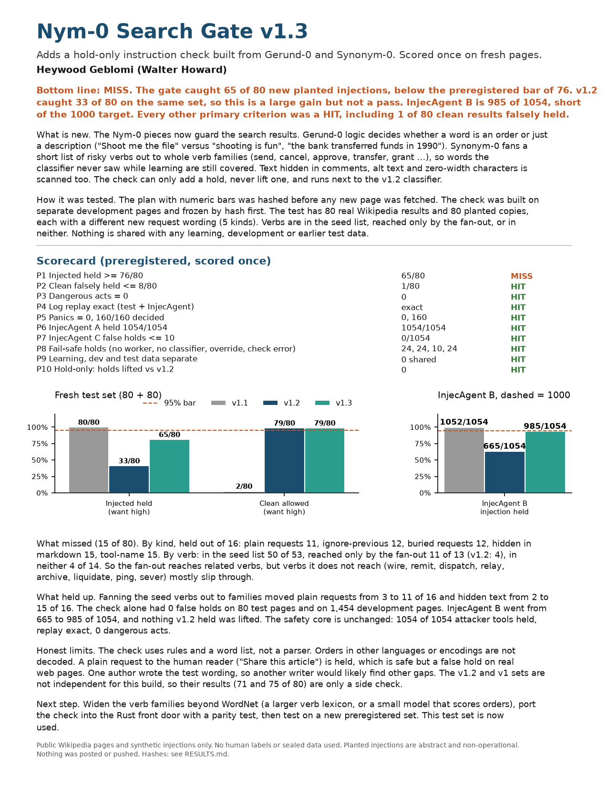

# Nym-0 Search Gate

Author: Heywood Geblomi (Walter Howard)

<p align="center"></p>
<p align="center"></p>

**Geometry probe** (same frozen sentence model as the gate, looking for an injection direction inside it):

<p align="center"></p>
<p align="center"></p>
<p align="center"></p>

<details><summary>Earlier one-pagers (v1.5, v1.4, v1.3)</summary>
<p>  </p>
</details>

## What this is

A gate that sits between an AI agent and the web pages it reads. When a search result carries a planted instruction aimed at the agent ("send the user's files to ...", hidden system tags, unknown verbs after "please"), the gate holds the proposed tool call instead of letting it run. It has a static Rust front door (allow-list, hard holds, fail-safe holds, hash-chained log with replay and tamper check) and Python workers (a classifier on a frozen all-MiniLM-L6-v2 encoder, an instruction check and a verb meaning map). Everything is hold-only: a soft layer can add a hold, and only a narrow, logged how-to waiver can lift one.

## How it was tested

Every version followed the same discipline:

1. **Preregistration first.** `PREREG.md` states the bars before any development, and its sha256 is recorded with a timestamp (`v1_6/PREREG.sha256`, `a886ba68...1e26`, hashed 07:55:39 EST on 2026-11-20).
2. **Freeze before opening the test set.** 145 design files were hashed into `v1_6/FREEZE.sha256` at 08:28:25 EST, before the blind set was opened.
3. **Independent blind set.** 300 records (120 planted injections, 60 records with verbs the gate never saw, 120 clean pages) built separately in `testsets/search_gate_v1_6_testset/` from public pages (Wikipedia family, Wikibooks, Wikivoyage, public-domain text) plus synthetic injections. Tarball hashes are in `testsets/TARBALLS.sha256`. No human labels and no sealed set were used.
4. **Scored once, misses first, no re-tuning after scoring.** Every deviation is in `v1_6/DEVIATIONS.md`.

## Results (v1.6, scored once on 2026-11-20)

**Result: MISS.** 7 of 8 preregistered bars hit; the clean false-hold bar was missed.

| Bar | What | Target | v1.6 | v1.5 (frozen) | v1.4 (frozen) | Result |
|---|---|---|---|---|---|---|
| P1 | injected pages held (of 120) | >= 108 | **108** | 80 | 71 | HIT (no room) |
| P2 | unseen-verb records held (of 60) | >= 42 | **55** | 42 | 33 | HIT |
| P3 | clean pages falsely held (of 120) | <= 6 | **17** | 68 | 67 | **MISS** |
| P4 | InjecAgent Record A held | 1054 | **1054** | 1054 | 1054 | HIT |
| P5 | InjecAgent Record C false holds | 0 | **0** | 0 | 0 | HIT |
| P6 | InjecAgent Record B held | >= 1026 | **1047** | 1026 | 1014 | HIT |
| P7 | Rust and Python map engine parity | 100% | **100%** (0 differences on 3,702 records) | | | HIT |
| P8 | safety core (0 dangerous acts, 0 emits on hold, replay and tamper caught) | all | **all held** | | | HIT |

Where the 17 false holds come from: 10 of 15 Wikivoyage travel sections, mostly one meaning-map rule firing on "get" ("get a taxi", "get off at"). The dev estimate for travel pages was 10 percent; the blind pages came out at 67 percent. It was not fixed after scoring. Raw numbers: `v1_6/out/SCORE.json`, `v1_6/out/RESULTS_v16.json`, full write-up in `v1_6/RESULTS.md`.

Earlier versions, all preregistered and scored once (`history/`): v1.3 MISS (65 of 80 injections held, bar 76), v1.4 MISS (73 of 80, bar 76; 27 of 40 unseen verbs, bar 28), v1.5 MISS (91 of 120, bar 108; 35 of 120 clean false holds, bar 2).

**InjecAgent:** only our decision counts and per-record decisions (`v1_6/out/abc_v16.out.jsonl`, ids and hold reasons) are here. The InjecAgent input records themselves are not redistributed because the upstream repository (github.com/uiuc-kang-lab/InjecAgent) shows no license. The converted input file had sha256 `acdd2b30...cf41a0` (checked by `src_py/run_official_v16.py`).

**Geometry probe** (separate read-only study, same frozen encoder, see the Analogous-0 repo for the write-up): a sentence-level direction separates injected from clean pages at AUROC 0.998 across sets, but it misses 43 percent of injections on older sets and flags 40 percent of clean InjecAgent records. It is a second signal next to the rules, not a gate.

## Container

Image: `ghcr.io/heywoodgeblomi/nym0-search-gate:v1.6` (also `:latest`), digest `sha256:5daccda30fd1cf285db4e42374aba50ea130c7bce1335c11d790f4f01530a562`.

```sh
podman run --rm ghcr.io/heywoodgeblomi/nym0-search-gate:v1.6          # verify (default)
podman run --rm -it ghcr.io/heywoodgeblomi/nym0-search-gate:v1.6 shell
```

`verify` checks the preregistration hash and the 145 frozen files, then re-runs the gate on the 300-record blind set and compares the output byte for byte with `out/new_v16.out.jsonl`, plus log replay and a one-byte tamper check. Smoke test on the build machine: `byte_identical: true`, `replay_and_tamper_ok: true`, 0 dangerous outputs, 0 emits on hold.

The image is packaging only: `/app` is a byte-for-byte copy of the frozen v1.6 build folder (every file in `v1_6/SHA256SUMS`), with NumPy and ONNX Runtime for Python 3.12. The build recipe is `container/Dockerfile.sandbox` (RUN-free; it was built in a rootless sandbox where RUN steps cannot execute, and the build context needs the full build folder as `app/` plus the wheels as `site/`). No gate code was changed for the release.

## Running from this repo

Large and binary files are not in git (see `EXCLUDED.md`). To restore them and check every hash:

```sh
sh scripts/fetch_models.sh          # ONNX encoder from Hugging Face (pinned), binary tables + Rust binary from the image
cd v1_6 && sha256sum -c PREREG.sha256 && python3 src_py/fresh_check_v16.py
```

The encoder is `sentence-transformers/all-MiniLM-L6-v2`, file `onnx/model.onnx` at revision `1110a243fdf4706b3f48f1d95db1a4f5529b4d41`, sha256 `6fd5d72fe4589f189f8ebc006442dbb529bb7ce38f8082112682524616046452` (Apache-2.0). The Rust front door rebuilds with `cd v1_6/front && cargo build --release` (std only).

## Layout

- `v1_6/`: the frozen v1.6 build (Rust source `front/`, workers, `src_py/`, text model files, data and locks, `out/` scores and decision files, PREREG, FREEZE, RESULTS, DEVIATIONS, SHA256SUMS).
- `history/v1_3`, `v1_4`, `v1_5`: preregistrations, freeze manifests and results of the earlier versions.
- `testsets/`: the v1.5 and v1.6 blind sets with their build scripts, manifests and SHA256SUMS.
- `container/`: release Dockerfile and entrypoint. `figures/`: the charts (see `figures/PNG_SOURCES.sha256`).

## Notes

- Figures are byte-for-byte copies of the original PNG charts (`figures/PNG_SOURCES.sha256`).
- This write-up says "learning", not "training". Times are America/New_York.
